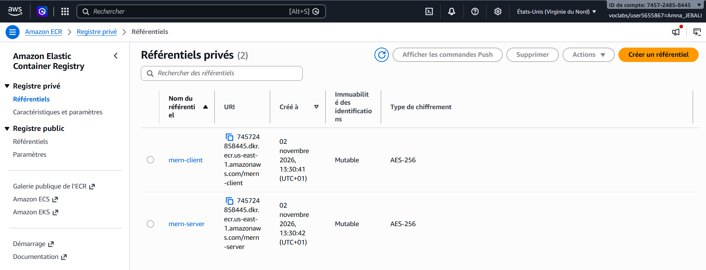
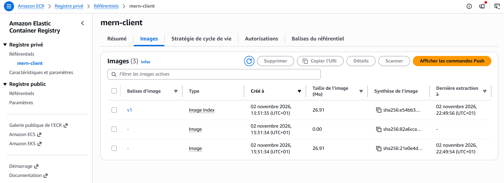
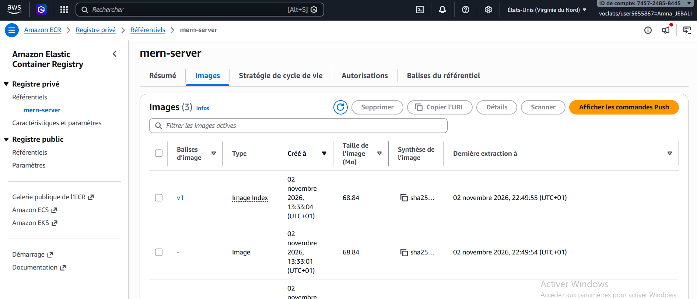
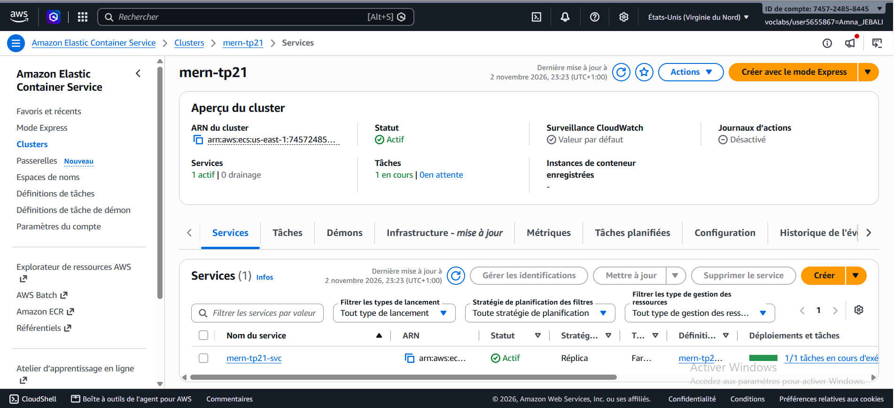
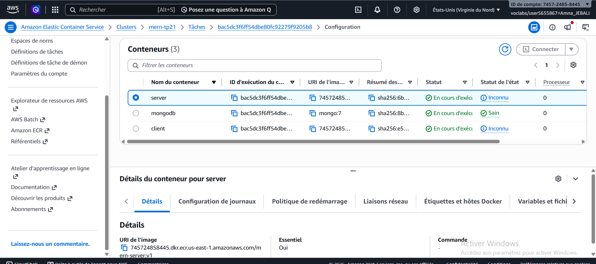
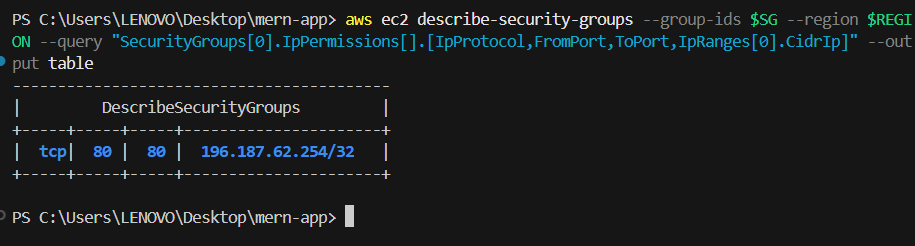
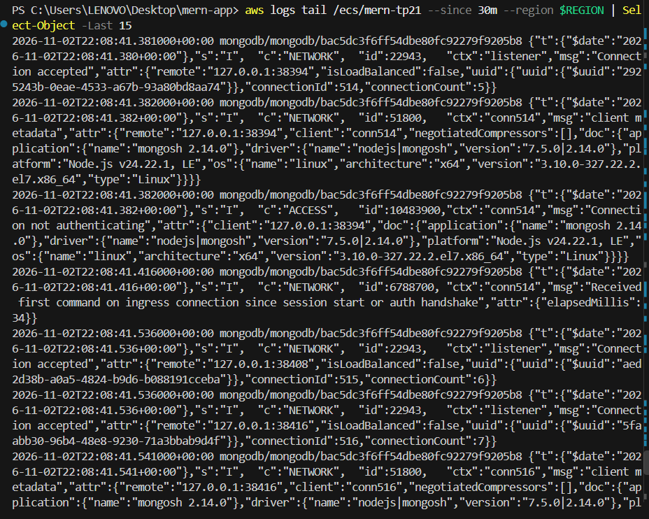
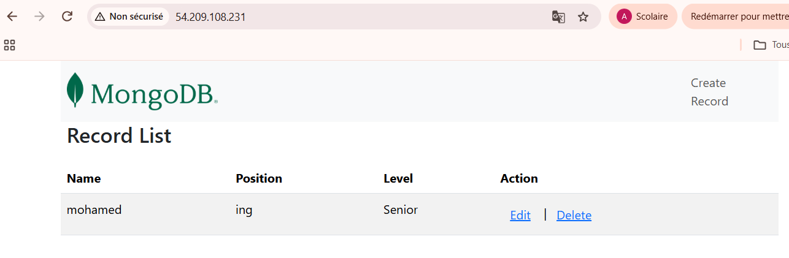
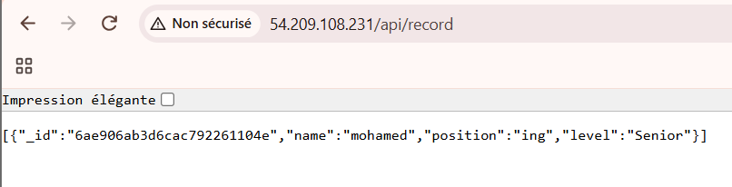
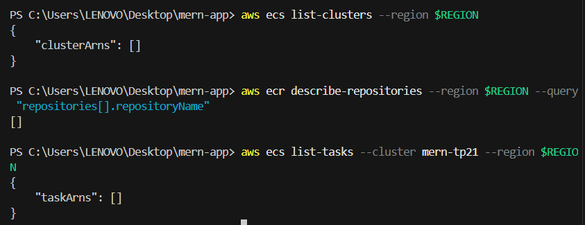

# TP2 DevOps : Docker, Docker Compose et déploiement AWS (application MERN)

Containerisation d'une application MERN (MongoDB, Express, React, Node.js) avec Docker,
orchestration avec Docker Compose (TP2), puis déploiement sur AWS ECR et ECS Fargate (TP2.1).

| Partie | Où la trouver |
|---|---|
| TP2 : Docker et Docker Compose | branche `main` (cette page, sections 1 à 3) |
| TP2.1 : AWS ECR et ECS | branche `tp2.1-ecs` (cette page, section 4) |
| Conteneurisation du projet micro-services | https://github.com/emnajebali2024/banking-microservices |

Remarque : sur la branche `tp2.1-ecs`, le client est servi par Nginx sur le port 80 et appelle
l'API par le chemin relatif `/api`. Le `docker-compose.yml` du TP2 correspond au Dockerfile du client
de la branche `main`.

## Structure du projet

```
mern-app/
├── client/              Application React (Dockerfile, .dockerignore, nginx.conf sur tp2.1-ecs)
├── server/              API Express (Dockerfile, .dockerignore)
├── ecs/                 Modèle de définition de tâche ECS (branche tp2.1-ecs)
├── docker-compose.yml   Orchestration du TP2
├── .env.example         Variables d'environnement documentées
└── docs/screenshots/    Captures d'écran
```

## 1. TP2 : déploiement manuel avec Docker

Prérequis : Docker Desktop démarré (Windows, WSL 2), Git, ports 3000 et 9000 libres.

Construction des images :

```powershell
cd server
docker build -t mern-server .
cd ..\client
docker build -t mern-client .
cd ..
```

Réseau, volume et MongoDB :

```powershell
docker network create mern-network
docker volume create mern-data
docker run -d --name mongodb --network mern-network -v mern-data:/data/db mongo
```

Serveur et client :

```powershell
docker run -d --name server --network mern-network -p 9000:9000 -e MONGO_URI=mongodb://mongodb:27017/mern mern-server
docker run -d --name client --network mern-network -p 3000:3000 mern-client
```

Nettoyage avant de passer à Compose :

```powershell
docker rm -f client server mongodb
docker network rm mern-network
docker volume rm mern-data
```

## 2. TP2 : Docker Compose

Le fichier `docker-compose.yml` définit trois services sur le réseau `mern-network` (driver bridge)
et un volume nommé `mern-data` :

- `mongodb` : image `mongo`, volume persistant, politique de redémarrage `unless-stopped`
  et healthcheck (`mongosh`).
- `server` : build de `./server`, port 9000, variable `MONGO_URI`, démarre quand `mongodb` est `healthy`.
- `client` : build de `./client`, port 3000, dépend de `server`.

Variables d'environnement (voir `.env.example`) :

| Variable | Rôle |
|---|---|
| `MONGO_URI` | URL de connexion à MongoDB. Dans Docker, l'hôte est le nom du service : `mongodb` |
| `REACT_APP_API_URL` | URL de l'API vue depuis le navigateur (`http://localhost:9000`) |

`REACT_APP_API_URL` est intégrée au bundle lors du build : le navigateur ne connaît pas les noms de
services Docker, il faut donc `http://localhost:9000` et non `http://server:9000`.

| Action | Commande |
|---|---|
| Construire et démarrer | `docker compose up --build -d` |
| État des services | `docker compose ps` |
| Logs d'un service | `docker compose logs --tail=50 server` |
| Arrêter (données conservées) | `docker compose down` |
| Arrêter et supprimer les données | `docker compose down -v` |


### Tests effectués

1. **Bout en bout** : depuis http://localhost:3000, ajout, modification et suppression d'un enregistrement
   (React, API Express, MongoDB).

   

2. **Persistance** : `docker compose down` (sans `-v`), vérification que le volume `mern-data` existe toujours,
   puis `docker compose up -d`. L'enregistrement créé avant l'arrêt est toujours présent.

   
   

### Diagnostiquer un service qui échoue au démarrage

1. `docker compose ps -a` : repérer l'état (`Exited`, `Restarting`, `unhealthy`).
2. `docker compose logs --tail=50 <service>` : lire l'erreur.
3. `docker inspect <conteneur>` ou `docker compose config` : vérifier variables, réseau et healthcheck.
4. `docker compose exec <service> sh` : tester depuis l'intérieur (par exemple `ping mongodb`).
5. Corriger puis `docker compose up --build -d`.

Causes fréquentes : `MONGO_URI` pointant vers `localhost` au lieu de `mongodb`, serveur démarré avant MongoDB,
port déjà utilisé sur la machine.

### Difficultés rencontrées (TP2)

- Moteur Docker injoignable (`failed to connect to the docker API`) : Docker Desktop n'était pas démarré.
- Port 3000 déjà utilisé : processus identifié avec `Get-NetTCPConnection -LocalPort 3000`, puis arrêté.
- Fichiers `.env` versionnés par le dépôt d'origine : retirés avec `git rm --cached`, ajoutés au `.gitignore`
  et remplacés par `.env.example`.
- URL de l'API côté client : `http://localhost:9000`, car l'appel est fait par le navigateur.

## 3. TP2 : projet micro-services

La conteneurisation du projet micro-services (Dockerfile et `.dockerignore` par service, `docker-compose.yml`
avec Kafka, volumes persistants, test de bout en bout) est dans un dépôt séparé :
https://github.com/emnajebali2024/banking-microservices

## 4. TP2.1 : déploiement sur AWS ECR et ECS (Fargate)

Déploiement du client React, de l'API Express et de MongoDB dans une seule tâche ECS Fargate,
avec les images publiées dans Amazon ECR (compte AWS Academy Learner Lab).

- **Région** : us-east-1 (N. Virginia)
- **Images ECR** :
  - `745724858445.dkr.ecr.us-east-1.amazonaws.com/mern-client:v1`
  - `745724858445.dkr.ecr.us-east-1.amazonaws.com/mern-server:v1`
- **Fichiers modifiés ou ajoutés** (branche `tp2.1-ecs`) :
  - `client/Dockerfile` : build React avec `REACT_APP_API_URL=/api`, servi par Nginx sur le port 80
  - `client/nginx.conf` : proxy de `/api/` vers `127.0.0.1:9000`
  - `ecs/task-definition.json` : modèle de la définition de tâche (`ACCOUNT_ID` est remplacé par le numéro
    de compte avant l'enregistrement, pour ne rien publier de spécifique au compte)

### Publication des images sur ECR

Authentification Docker avec `aws ecr get-login-password`, création des deux dépôts privés `mern-client` et
`mern-server`, puis `docker tag` et `docker push` des images `v1`.





### Configuration ECS

- Définition de tâche `mern-tp21` : Fargate, Linux/x86_64, réseau `awsvpc`, 1 vCPU, 2 Gio.
- Rôle d'exécution : `LabRole` (le rôle `ecsTaskExecutionRole` ne peut pas être créé dans le Learner Lab).
- Trois conteneurs dans la même tâche, qui communiquent par `localhost` :
  - `mongodb` (`mongo:7`) : port non exposé, healthcheck `mongosh`
  - `server` : image ECR, port 9000, `MONGO_URI=mongodb://127.0.0.1:27017/employees`,
    démarre quand `mongodb` est `HEALTHY`
  - `client` : image ECR, port 80, démarre après `server`
- Journaux CloudWatch (`/ecs/mern-tp21`), cluster `mern-tp21`, service Fargate avec une seule tâche.
- Sous-réseau public, IP publique activée. Le security group autorise uniquement TCP/80 depuis une seule
  adresse IP : les ports 9000 et 27017 ne sont pas ouverts.






### Tests

Avant le déploiement, les images ont été testées en local en reproduisant le réseau partagé d'une tâche
Fargate (`docker run --network container:<conteneur>`).

Sur AWS, via l'IP publique de la tâche :

- `http://<IP_PUBLIQUE>/` : l'application React se charge.
- `http://<IP_PUBLIQUE>/api/record` : l'API répond en JSON.
- Création d'un enregistrement depuis le navigateur, puis lecture dans la liste.

La modification et la suppression passent par les mêmes routes de l'API que celles testées dans la partie TP2.




### Difficultés rencontrées (TP2.1)

- Le rôle `ecsTaskExecutionRole` ne peut pas être créé dans le Learner Lab : utilisation de `LabRole`.
- Le port 8080 de la machine était déjà utilisé lors du test local : utilisation du port 8088.
- Les commandes ECS ont été refusées (`AccessDeniedException`) lorsque la session du lab avait expiré :
  redémarrage du lab et mise à jour des clés temporaires.
- Une règle du security group a été retirée par erreur lors d'une mise à jour d'adresse IP : elle a été
  recréée. Le port 80 n'a jamais été ouvert à d'autres adresses.

### Suppression des ressources

Le service ECS a été ramené à 0 tâche puis supprimé, puis le cluster, la définition de tâche, les deux dépôts
ECR (et leurs images), le groupe de journaux CloudWatch et le security group. Aucune tâche active ne reste.



### Remarques

- MongoDB utilise le stockage temporaire de Fargate : les données sont perdues à l'arrêt de la tâche.
- L'accès se fait en HTTP, sans HTTPS, sur une IP publique : ce déploiement est uniquement pédagogique.
- Aucun secret n'est publié : les clés temporaires du Learner Lab restent dans `~/.aws/credentials`, hors du dépôt.